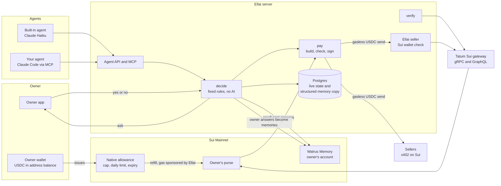
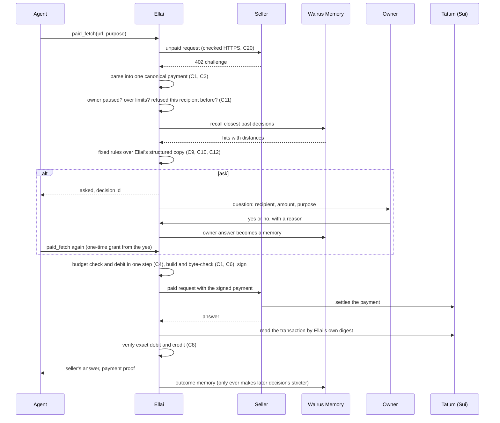
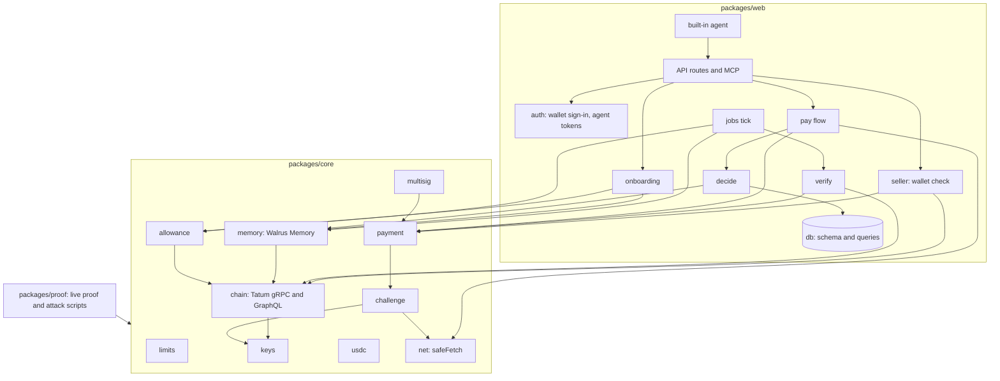

# Ellai architecture

Ellai lets your AI agent pay for things on Sui. Before every payment Ellai decides: pay, refuse, or ask you. It learns from your own yes and no answers, which live in your own Walrus Memory account, so it asks less over time and still stops the odd payment.

This file is the backend design. The security rules every module must uphold are in [docs/security/threat-model.md](docs/security/threat-model.md); references like C4 point there.

## System overview

## One paid call, end to end

## Module dependency graph

## How Ellai decides

Every rule is fixed code. No AI model ever decides about money.

1. **Hard limits first.** Paused owner, a payment above the owner's per-payment maximum, or a daily budget already spent: refuse.
2. **A refusal always wins (C11).** An exact lookup by recipient address in Ellai's own records. If the owner ever refused this recipient, refuse and cite that memory.
3. **Bad outcomes make Ellai stricter.** If this recipient took a payment and returned nothing since the owner last approved it, ask, and cite the outcome.
4. **A one-time grant.** When the owner answers yes to a question, that yes allows exactly one payment with the same recipient, at most the same amount, from the same seller request, within ten minutes. Then it is used up.
5. **Learned approval.** Recall the closest past decisions from the owner's Walrus Memory, with a distance cutoff. Approve only if at least two of the owner's own approvals are for the same recipient, at or above this amount, and close in meaning to this purpose. Trust follows the money: approvals for one recipient never count for another (C2).
6. **Otherwise ask.** A search that errors, comes back empty, lacks a numeric distance, or reaches its result limit means ask (C12).

Only memories Ellai wrote from an owner's answer count toward approval. Outcomes never do (C9). Rules read Ellai's structured copy of each memory, keyed by its Walrus blob id, never the sentence text (C10).

## Money on chain

- The owner's USDC stays in the owner's own address. The owner signs one transaction issuing a native Sui allowance to their purse: a total cap, a daily limit and an expiry. The owner can revoke it at any time.
- Each owner has their own purse. Ellai derives its key per owner from one master secret, so no two owners share a purse (C7).
- The purse holds a small float, refilled from the allowance only when it runs low, a fixed small amount at a time, a few times a day at most (C23). Ellai's gas wallet pays the refill's network fee.
- Each payment is a plain gasless USDC send from the purse, built from the canonical payment and checked byte for byte before signing (C1, C6). The seller settles it. Ellai then reads the transaction through Tatum by the digest it computed itself, and verifies exactly one debit and one credit of the agreed amount (C8).

## Data

Postgres (Neon) holds what must be current: owners, sessions, agent tokens (hashed), decisions, owner answers and grants, payments and their verification, the daily budget ledger, refills, memory write jobs, and the structured copy of every memory Ellai wrote. Walrus Memory, in the owner's own account, holds the decisions and lessons as plain sentences that the owner owns, can read from any tool, and can verify on chain.

## Sponsor technology, and what each part does

| Technology | What Ellai uses it for |
|---|---|
| Walrus Memory | Every owner answer and lesson, in the owner's own account; meaning-based recall of past decisions; Ellai is one delegate key the owner can remove |
| Tatum Sui gRPC | Balances, transaction effects for settlement checks, executing refills, the current epoch, the Ellai seller's wallet check |
| Tatum Sui GraphQL | Listing the owner's Walrus Blob objects for the proof page |
| Sui native allowance | The owner's spending cap, daily limit and expiry, enforced on chain |
| Sui gasless stablecoin transfers | Every payment to a seller; the purse needs no SUI |
| x402 on Sui | The payment challenge and payment header between Ellai and each seller |
