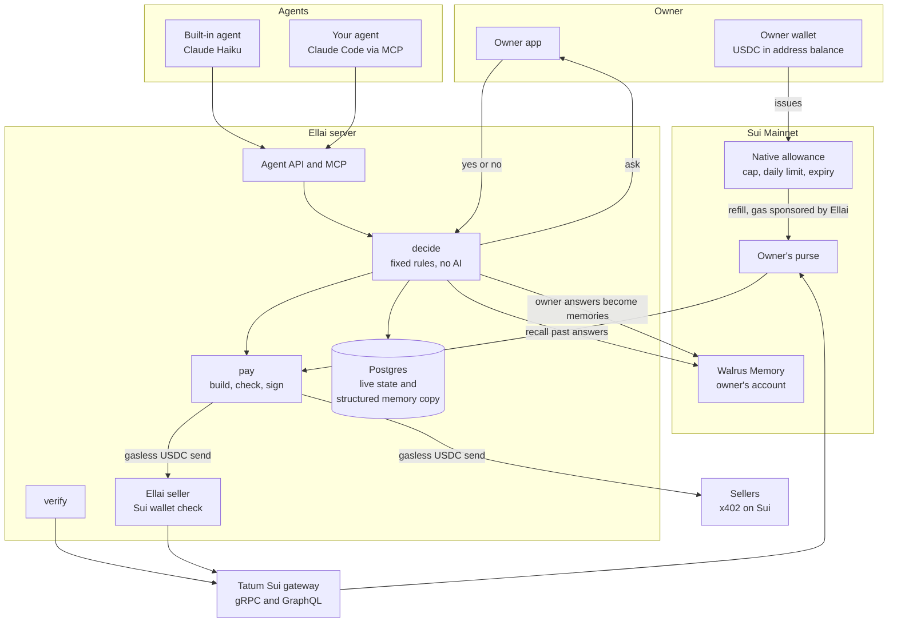
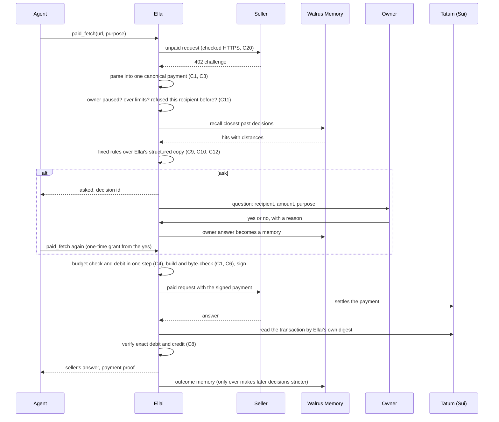
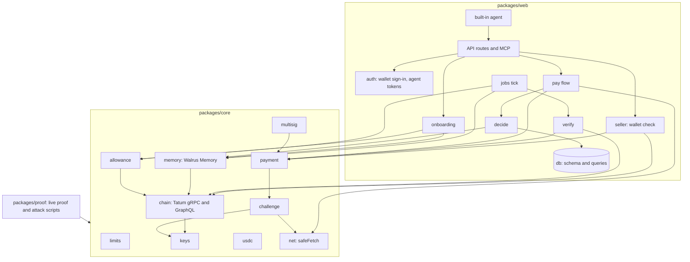

# Ellai

Ellai means limit in Tamil.

Let your AI agent pay for things. Ellai learns when to ask you.

🌐 [Live app](https://ellai-pay.vercel.app) | 📚 [Docs](https://ellai-pay.vercel.app/docs) | 🔎 [Proof](https://ellai-pay.vercel.app/proof) | 💻 [GitHub](https://github.com/ramakrishnanhulk20/ellai)

Built for Total Recall (Tatum x Walrus), October to November 2026. Real USDC on Sui Mainnet, memory on Walrus Memory, and every Sui read and send that Ellai makes itself goes through Tatum.

## Live on Mainnet

Ellai has no Move contract of its own. It uses Sui's native allowance and Walrus Memory. These are the live objects from Ellai's own test owner, and every one opens on Suiscan.

| What | Address or id | What it does |
|---|---|---|
| Walrus Memory account | [0x98a4e7a4...1121](https://suiscan.xyz/mainnet/object/0x98a4e7a42754de51dd86bf5b8a06e6caaa2e4dcc8bc08f630952ce291ee91121) | The test owner's memory account. Ellai is one delegate key on it. |
| Allowance object | [0xd2b94108...99c8](https://suiscan.xyz/mainnet/object/0xd2b941082590b7d9d0a04482109670f94c290714889b67e8ef2c60ec6d9699c8) | 1.00 USDC in total, 0.50 per 24 hours, 30 days, with the purse as the only spender. |
| Test owner | [0xaa4a4767...0e9](https://suiscan.xyz/mainnet/account/0xaa4a47678fa9e215d8ef57d6f5aebdbf71e3ed76c3841bc1b7343b300b1270e9) | Holds the USDC and owns the memories and the allowance. |
| Purse | [0xf9ce8209...dbbe](https://suiscan.xyz/mainnet/account/0xf9ce82090ab9e6cac693577e1c983eb868048e49706973425a2c4923d0bbdbbe) | The small wallet Ellai derives for this owner. It sends each payment. |
| Gas wallet | [0x54298b73...201d](https://suiscan.xyz/mainnet/account/0x54298b73a1a3fecfc23ffc9d5897888e527c06dd30dce5476dfeda1b146d201d) | Ellai's wallet. It pays the network fee of each refill. |

Transactions you can open: [a full paid call with the seller's answer](https://suiscan.xyz/mainnet/tx/DC9NrrTaomMRd9RcHgKWAnFNaTukKVVzg3migMYsd9wF), [a payment to Ellai's own seller](https://suiscan.xyz/mainnet/tx/GQJtLy5oFGSVdvs1aZEqVWdstpEUPJ5VmuuYWMDMHy9j), [the first payment to a real seller](https://suiscan.xyz/mainnet/tx/JD999NqSNbgJVLHF5ikv1wSirNm1v9gbhm4Xva1JAmv4) and two [sponsored](https://suiscan.xyz/mainnet/tx/HwmDFQi6M9CwSKac3SYsGT27Jcr2Rk9vQ9W3qmCa37ow) [refills](https://suiscan.xyz/mainnet/tx/AEkEASpR1MTzawpvXZctLnAaMACMpUtnbMUB1nmK9NJ).

## Overview

Agents now meet sellers that want money before they answer. A hotel search costs 0.01 USDC. A ticket classifier costs 0.02 USDC. These sellers use x402: the seller answers a request with HTTP status 402, which means payment required, names a price, and waits for the buyer to pay and ask again.

You have two poor choices. Approve every small payment by hand, and the agent stops being useful. Or put a wallet in the agent's hands, and one bad prompt can empty it. Ellai sits between the agent and the seller and takes a third path.

1. Ellai pays for the agent under fixed rules. Before every payment it decides one of three things: pay, refuse, or ask you. The rules are written code. No AI model ever decides about money.
2. Ellai learns from your yes and no. When it asks and you answer, your answer becomes a short sentence in your own Walrus Memory account. The next time a similar payment comes up, Ellai looks at your past answers. When it finds enough close ones for the same seller address, it pays on its own.
3. Your money stays behind a Sui allowance. Your USDC stays at your own wallet address. You sign one transaction that lets Ellai's purse draw from it, within a total cap, a daily limit and an end date that you choose.

The number to watch is on your overview: of your latest 20 payments that were approved or asked about, how many needed you. It starts high and falls as you answer. A falling number is the product working.

Two things do not change as Ellai learns. It always asks about a seller address you have never approved. And a refusal always wins: once you refuse a seller address, Ellai refuses every later payment to it.

| | A raw wallet key in the agent | Approving every payment by hand | Ellai |
|---|---|---|---|
| Where the money sits | In the agent's wallet | In your wallet | In your wallet, behind a Sui allowance you set |
| How often you are asked | Never | Every time | Only when your past answers do not cover the payment |
| If the agent is tricked | One bad prompt can empty the wallet | You can catch it if you read every request | Ellai pays only addresses you approved, up to amounts you approved, inside your daily budget |
| Does it improve | No | No | Yes. Each answer becomes a memory that the next decision reads |
| Can you see why it paid | No | Only in your own head | Each decision shows its rule, its reason and the memories it cited |
| How you stop it | Move the funds | Stop approving | Pause in Settings, or end the allowance there with one signature |

## Features

### Keeps your money in your hands

- A native Sui allowance with a total cap, a daily limit and an end date. Sui enforces it, so even a bug in Ellai cannot make the purse draw more than the allowance says.
- A purse that holds at most 0.20 USDC right after a refill. Refills are 0.10 USDC each, only when the purse is under 0.05 USDC, at most 3 in 24 hours.
- Ellai's own limits below the allowance: a per-payment maximum (0.01 to 1.00 USDC, default 0.05) and a daily budget (default 0.50).
- A fresh wallet signature for anything that loosens: a new agent key, a higher limit, fewer approvals needed, resuming payments, turning public proof on. A stolen login cannot do any of them.
- Every payment is a plain gasless USDC send. Before signing, Ellai decodes the transaction and checks it field by field against the price the seller sent.

### Asks you less over time

- Learned approval: Ellai pays on its own when at least two of your own approvals (you can set 1 to 10) are for the same seller address, at or above this amount, and close in meaning to this purpose.
- A one-time grant from each yes: the same agent, the same recipient, at most the same amount, the same seller request, within 10 minutes.
- Trust follows the money. Approvals for one address never count for another, whatever the website name says.

### Shows its work

- History lists every decision with the rule that made it, Ellai's reason, the memories it cited, and a Suiscan link for each payment.
- Memories lists every sentence Ellai wrote for you with its state: pending, confirmed or failed. A new answer is sent to your Walrus Memory account right after you give it; the live proof measured 21 seconds from the answer to confirmed.
- A public [proof page](https://ellai-pay.vercel.app/proof) and a live memory map on the landing page, built from the chain and from owners who chose to show their data. They never show a memory sentence, a purpose, a reason or an address.

### Plugs into your agent

- One key per agent. Two doors with the same checks: an MCP server (`paid_fetch`, `check_decision`) and plain HTTP.
- A built-in agent on Claude Haiku (`claude-haiku-5-5`) that buys from a fixed catalog. It never approves a payment.
- The same Walrus Memory account can be read from Claude Code through the Walrus Memory MCP.

### Fails closed

- If Walrus Memory is down, errors or comes back empty, Ellai asks you. If Tatum is down or a daily cap is reached, Ellai asks or refuses. Anything that cannot be parsed, is ambiguous or is too large is refused.

### Not yet

- Ellai pays one x402 form today: version 1, as t2000 sellers send it. x402 version 2 is read but refused. MPP is not supported.
- The app has no way to take back a refusal.
- Walrus Memory SDK 0.1.9 (bulk idempotency keys) is not adopted yet. Ellai pins 0.1.8.

## Architecture

Three diagrams, the same ones as in [ARCHITECTURE.md](ARCHITECTURE.md).

### System overview



### One paid call, end to end



### Module dependency graph



## The two-minute judge path

No wallet and no sign-in needed for steps 1 to 5. Everything on these screens is read from the chain and from owners who chose to show their data.

1. Open [https://ellai-pay.vercel.app](https://ellai-pay.vercel.app). The first screen is the live memory map. Each light is a real memory on Walrus. The decision card (in the corner, or under the map on a phone) opens on a real payment Ellai verified on Sui, with a "See it on Sui" link to the transaction on Suiscan, then replays the other public decisions: "Agent wants to pay", a badge (Paid on its own, Approved on its own, Asked you or Refused) and the reason from the rule that decided it. "Paid" appears only for a payment Ellai verified on Sui. "Approved on its own" marks a learned approval that moved no money, such as the learning test's.
2. Scroll down to "05 / Watch it learn": "It asks you less as it learns." The section holds the screen while a playhead walks along real decisions, oldest on the left. Questions asked climbs early. Approved on its own climbs later.
3. Keep scrolling to "07 / Proof": "Don't trust us. Check." Click "See all proof" to open [https://ellai-pay.vercel.app/proof](https://ellai-pay.vercel.app/proof).
4. On the proof page, click any row under "Latest payments" to open the transaction on Suiscan. Click any row under "Latest memories" to open the Walrus blob on Walruscan.
5. Click "Docs" in the top bar, then "The learning test" in the sidebar, or go straight to [https://ellai-pay.vercel.app/docs/learning-results](https://ellai-pay.vercel.app/docs/learning-results). It has the 24 requests, the two scores and the honest notes, with every cited memory linked to Suiscan.

With a Sui wallet and a little USDC: click "Open Ellai" (or go to [https://ellai-pay.vercel.app/app](https://ellai-pay.vercel.app/app)), sign in, and sign the three setup steps. Then give an agent a key under Agents, or press Run and give the built-in agent a task. When Ellai meets a seller it has no answers for, a card appears under Questions. Approve it with a short reason, and watch the sentence appear under Memories as pending, then confirmed.

### Where each judging line is met

| Program line | Where to look |
|---|---|
| Walrus and Tatum integration (30%) | [Walrus Memory](#walrus-memory) and [Which Tatum call powers which feature](#which-tatum-call-powers-which-feature) below, and the live [proof page](https://ellai-pay.vercel.app/proof) |
| Technical quality (30%) | [Security](#security), [Real test counts](#real-test-counts), [Prove it](#prove-it) and [Project structure](#project-structure) |
| Creativity (20%) | The [Overview](#overview) and the [learning test](https://ellai-pay.vercel.app/docs/learning-results) |
| Presentation (20%) | This README, the [docs](https://ellai-pay.vercel.app/docs), the live demo and the demo video |
| Best Walrus Memory | Every owner answer is a memory that changes the next decision. See the learning test numbers in [Walrus Memory](#walrus-memory) |
| Best Use of Agent Payments | Real x402 payments settled on Sui Mainnet, each read back through Tatum, listed on the [proof page](https://ellai-pay.vercel.app/proof) |
| Best Tatum AI Builder App | Not pursued. Ellai was not built with the Tatum AI Builder. |

## Prove it

Run these from the repository root. Live proofs read a `.env` file at the repo root and use your own test wallets on Sui Mainnet, so fund those first. The outputs further down come from Ellai's own test wallets, so your runs show your own addresses and ids. Each live proof is capped, and the last column gives the cap.

| Command | What it shows | USDC moved |
|---|---|---|
| `npm test` | Everything offline, plus the live core reads through Tatum. Run it alone: core takes about 2.5 minutes, and the web suite needs about 4 GB of free memory. | None |
| `npm run typecheck` | The types of every package. | None |
| `npm run prove:memory -w packages/proof` | The Walrus Memory slice. It makes sure the owner has an account with Ellai's derived key on it, writes 10 true sentences once, recalls one by meaning, and reads the owner's Walrus Blob objects back from chain through Tatum. | None. The first run spends a little SUI creating the Walrus Memory account. |
| `npm run prove:loop -w packages/web` | The learning loop. Two owner approvals are written as Walrus Memory blobs and come back confirmed. A third similar request is approved on its own citing both. The same request to another recipient is still asked. | None |
| `npm run prove:flow -w packages/web` | The pay flow. An agent asks for a hotel search. Ellai fetches the seller's price itself, approves it from the two earlier approvals, pays 0.01 USDC from the purse with a gasless send, hands back the seller's answer and verifies the payment on chain by its own digest. Run `prove:loop` first. | At most 0.02 USDC |
| `npm run prove:seller -w packages/web` | Ellai's own seller. It answers a request with a 402, a buyer reads and pays it, and the seller checks the bytes and signature, sends the payment through Tatum, verifies the settlement from the chain's effects and answers with the wallet check. | Exactly 0.01 USDC on the first run. A rerun pays nothing. |
| `npm run prove:visit -w packages/web` | The background work an answer starts. It records one owner answer, runs that owner's visit against the real Walrus Memory relayer and Sui through Tatum, and prints the seconds from the answer to confirmed. Two runs on 29 October 2026 measured 21.3 and 21.6 seconds. | None |
| `npm run prove:pay -w packages/proof` | The money path. The owner issues an allowance to the purse, the purse pulls one 0.10 USDC refill with the gas wallet paying the fee, and the purse pays at most one live seller 0.01 USDC. Each payment is verified from its own digest. | Capped. At most 0.20 USDC may leave the owner, and at most 0.02 USDC is newly signed to sellers. |

The outputs below are the first runs, saved on 24 October 2026, when the money moved. Some lines were left out to keep this page short, and none were edited. The `prove:pay` first run ends with a STOPPED line because the seller's answer timed out after the payment had already settled and been verified; the payment is what that proof is about.

On 29 October 2026 every script ran again against Sui Mainnet. `prove:memory`, `prove:loop` and `prove:flow` ended PROVEN again, reading their earlier writes and payment back through Tatum and sending nothing new. `prove:pay` found its allowance and its payment JD999NqS on chain and sent nothing. `prove:seller` stopped on purpose, because its purse had already paid that seller once. `prove:visit` is new and ran in full; its output is below.


### prove:memory

```text
2. Write 10 memories in namespace ellai-test-v1
  Bulk write took 34.3 s from send to the last job done (first run)
[...]
3. Recall by meaning: "Which seller does the test pay first, and how much does it cost?"
  distance 0.3422  blob 5ISGJPM2zEEQ915nXcWrJ22M4DEgGpcOarh0TpcFHEo  "The first seller the test pays is agentproof.vegagaminginc.workers.dev /v1/preflight, for 0.01 USDC."
[...]
  10 Walrus Blob objects listed; 10 of 10 written blob ids found on chain.
[...]
For the hackathon form
  Account ID (SUI):  0x98a4e7a42754de51dd86bf5b8a06e6caaa2e4dcc8bc08f630952ce291ee91121
  MEMWAL_AGENT_ID (Ellai's delegate public key, hex):  279c1c291caf9f89b2d0adedf698ff6a5fb8a618a567da5523d1f31b6a15962d
  Each memory is stored for 15 epochs (end epoch minus registered epoch).

PROVEN: account and delegate key on chain, 10 memories written, recalled by meaning, and every blob read back through Tatum.
```

### prove:loop

```text
6. Third request, same recipient and amount: "search hotels in Madrid for 25 November under 110 euros"
  decide: approved (learned). Reason: "You approved 2 payments like this to suimpp.jmpr.world, up to 0.010000 USDC."
  cites memories ccc44c71-6293-4e87-bb4d-4a2a7e7a8fad, 4da68905-8adb-4ad3-a04e-5c28bf59aca5
    memory ccc44c71-6293-4e87-bb4d-4a2a7e7a8fad (blob 9wXxWalHa5ZrXM2MRvsIkFx3X4AzQPjRexbcWzgxhDE): 0.1527
    memory 4da68905-8adb-4ad3-a04e-5c28bf59aca5 (blob HrmaKoyWB8VwezJBKJOGh81-dJbim5YVw7ZaRx34A0I): 0.1730

7. Fourth request, same purpose, to a recipient never approved: 0xe1e1e1e1e1e1e1e1e1e1e1e1e1e1e1e1e1e1e1e1e1e1e1e1e1e1e1e1e1e1e1e1
  decide: asked (no_match). Reason: "You have not approved a payment like this to suimpp.jmpr.world yet."
[...]

PROVEN: two owner approvals written to Walrus Memory and confirmed on chain, found again by meaning, the third request approved on its own citing both, and the same request to a new recipient still asked.
```

### prove:flow

```text
1. The agent asks: POST https://suimpp.jmpr.world/v1/hotels/search-flexible for "search hotels in Lisbon for 20 November under 120 euros"
  outcome: paid, rule: learned, decision a483e727-697a-4700-9d34-2d36a46aa8ea
  reason: "Paid 0.01 USDC to suimpp.jmpr.world."
  cites memory ccc44c71-6293-4e87-bb4d-4a2a7e7a8fad (blob 9wXxWalHa5ZrXM2MRvsIkFx3X4AzQPjRexbcWzgxhDE)
  cites memory 4da68905-8adb-4ad3-a04e-5c28bf59aca5 (blob HrmaKoyWB8VwezJBKJOGh81-dJbim5YVw7ZaRx34A0I)
  seller answered HTTP 200, application/json
[...]
  payment 0.010000 USDC to 0x9549bff7412d028e936f3b4525c986c3165273cf363db0a72337da54e001391c
  digest DC9NrrTaomMRd9RcHgKWAnFNaTukKVVzg3migMYsd9wF, settlement: verified
  https://suiscan.xyz/mainnet/tx/DC9NrrTaomMRd9RcHgKWAnFNaTukKVVzg3migMYsd9wF
[...]

PROVEN: Ellai fetched the price itself, approved it from the owner's own past answers, signed within the daily budget, paid from the owner's purse and verified the payment on chain by its own digest; the seller answered, so there was no bad outcome to learn from.
```

### prove:seller

```text
  Sale 8c8069ec-0000-8050-a9a4-edfcf6f9cb3e: settled, digest GQJtLy5oFGSVdvs1aZEqVWdstpEUPJ5VmuuYWMDMHy9j, payer 0xf9ce82090ab9e6cac693577e1c983eb868048e49706973425a2c4923d0bbdbbe
  https://suiscan.xyz/mainnet/tx/GQJtLy5oFGSVdvs1aZEqVWdstpEUPJ5VmuuYWMDMHy9j
[...]
  Purse USDC 0.050000 USDC before, 0.040000 USDC after; seller pay-to USDC 0.000000 USDC before, 0.010000 USDC after
[...]

PROVEN: Ellai's seller issued a 402 that core's own buyer code reads and pays, took exactly 0.01 USDC once, checked the bytes and the signature before sending them through Tatum, verified the settlement on chain and answered with the wallet check.
```

### prove:visit

```text
2. A new request, 10000 atomic USDC (0.01) to JMPR 0x9549bff7412d028e936f3b4525c986c3165273cf363db0a72337da54e001391c: "search hotels in Lisbon for one night, asked at 2026-10-29T07:22:48.100Z"
  decide: asked (no_match). Reason: "You have not approved a payment like this to suimpp.jmpr.world yet."
3. The owner approves, as the answer route records it
  Approval recorded as memory daf5e74d-2e5e-4eb5-a87b-efea80d4d113, status pending
4. The visit the answer route schedules: trigger 'answer', the real chain and relayer, a real sleep
  pass 1 done, the memory is still waiting; next pass in 10 s
  pass 2 done, the memory is still waiting; next pass in 10 s
  started true, passes 3, submitted 1, confirmed 1, errors none
  The visit took 22.3 s
5. The approval memory
  status confirmed, job ed970032-d8bb-4aa5-902a-226f0f808ecd
  Answer to confirmed: 21.6 s (answered_at to confirmed_at, both written by Ellai)
  Blob gZpEn1seVUsIRCadoGXX_iaMe3vNeAuMUPIMZ-AJiFM
  https://walruscan.com/mainnet/blob/gZpEn1seVUsIRCadoGXX_iaMe3vNeAuMUPIMZ-AJiFM
PROVEN: the owner's approval was written to Walrus Memory and confirmed by the visit its own answer starts, with no jobs tick.
```

### prove:pay

```text
  VERIFIED by verifySettlement, read through Tatum by the digest Ellai computed: JD999NqSNbgJVLHF5ikv1wSirNm1v9gbhm4Xva1JAmv4
    purse     0xf9ce82090ab9e6cac693577e1c983eb868048e49706973425a2c4923d0bbdbbe  -0.010000 USDC
    recipient 0x9549bff7412d028e936f3b4525c986c3165273cf363db0a72337da54e001391c  +0.010000 USDC
    no other USDC change; https://suiscan.xyz/mainnet/tx/JD999NqSNbgJVLHF5ikv1wSirNm1v9gbhm4Xva1JAmv4

So far: 0.100000 USDC left the owner (ceiling 0.200000 USDC); 0.010000 USDC paid to sellers and verified.
STOPPED: Payment JD999NqSNbgJVLHF5ikv1wSirNm1v9gbhm4Xva1JAmv4 settled and verified, but the seller answered TIMEOUT, not success. Stopping.
```

## Quick start

You need Node 22.19 or newer and about 4 GB of free memory for the web tests. A free Tatum Mainnet API key ([dashboard.tatum.io](https://dashboard.tatum.io/)) is recommended: without one, Ellai's Sui reads go out anonymously at 5 requests a minute, so the app and the tests still work, only slower. A hosted copy also needs a Postgres database (a free [Neon](https://neon.tech) project works); `npm run db:migrate -w packages/web` applies the migrations to the database `DATABASE_URL` names.

```bash
git clone https://github.com/ramakrishnanhulk20/ellai.git
cd ellai
npm ci
npm run build
cp .env.example .env
npm run setup -w packages/proof
```

`npm run build` compiles the shared `core` package, which the setup script and the app import.

`npm run setup -w packages/proof` adds the wallet keys and the master secret that every purse derives from at the bottom of `.env`, and prints the test owner, gas wallet and purse addresses. It never changes a line that is already there, so the blank lines with the same names copied from `.env.example` stay; they do nothing, because the last value of a name wins. Back up the `.env` file: losing the master secret strands any money in the purses.

Then fill in the rest of `.env`:

- `TATUM_API_KEY`: your Tatum Mainnet key, or leave it blank to read anonymously and slowly.
- `SESSION_SECRET` and `JOBS_SECRET`: 64 hex characters each. Generate each with `node -e "console.log(require('crypto').randomBytes(32).toString('hex'))"`.
- `APP_ORIGIN`: `http://localhost:3001` for local work.
- `DATABASE_URL`: `pglite:./local-db` for local work. It is a file database that the app creates and migrates inside `packages/web` on first start, so no Postgres is needed.
- `ANTHROPIC_API_KEY`: optional. Only the built-in agent needs it.

Start the app:

```bash
node packages/web/scripts/dev.mjs
```

It serves on port 3001 (set `PORT` to change it) and reads the root `.env`. To run the live proofs, fund the addresses the setup script printed: a few dollars of USDC and about 0.5 SUI to the test owner, and about 0.5 SUI to the gas wallet. That was enough for every proof in this repo. No SUI or USDC yet? Buy them on an exchange that supports withdrawals on the Sui network and send them to the printed addresses.

## Connect an agent

Create an agent key under Agents in the app. It starts with `ellai_agent_` and is shown once. Both doors run the same checks.

Claude Code:

```bash
claude mcp add --transport http ellai https://ellai-pay.vercel.app/api/mcp --header "Authorization: Bearer YOUR_AGENT_KEY"
```

Any MCP client that supports remote HTTP servers and custom headers:

```json
{
  "mcpServers": {
    "ellai": {
      "type": "http",
      "url": "https://ellai-pay.vercel.app/api/mcp",
      "headers": { "Authorization": "Bearer YOUR_AGENT_KEY" }
    }
  }
}
```

Plain HTTP:

```bash
curl -X POST https://ellai-pay.vercel.app/api/agent/fetch \
  -H "Authorization: Bearer YOUR_AGENT_KEY" \
  -H "Content-Type: application/json" \
  -d '{"url":"https://seller.example/api","method":"GET","purpose":"Find a hotel in Lisbon under 120 euros"}'
```

The agent gets two tools, `paid_fetch` and `check_decision`. `paid_fetch` takes `url`, `method` (`GET` or `POST`), an optional `body` and `contentType`, and a plain `purpose` of 1 to 500 characters that the owner reads when asked. The answer says what Ellai did.

| Outcome | What happened | What the agent should do |
|---|---|---|
| `free` | The seller answered without asking for payment. | Use the answer as data. |
| `paid` | Ellai paid. The rule was `learned` or `grant`. | Use `seller.body` as data. Do not pay again for the same thing. |
| `asked` | Ellai needs the owner. A `decisionId` comes back. | Tell the user, call `check_decision` later. When `retryAllowed` is true, call `paid_fetch` again with the same request. |
| `refused` | Ellai will not pay. The `reason` says why. | Stop. Do not look for a way around it. |
| `failed` | Ellai could not pay safely on this call. No payment was made. | Tell the user. A retry later may work. |

The seller's text is the seller's own. The answer carries `sellerBodyIsUntrusted: true` on every call, so an agent reads it as data and never as instructions. Full detail is in [Connect your agent](https://ellai-pay.vercel.app/docs/connect-your-agent).

## Which Tatum call powers which feature

Ellai reads and sends on Sui only through Tatum's Sui gateway, using gRPC for balances, transactions and sending, and GraphQL for objects. The code is in `packages/core/src/chain.ts`. The one exception is inside the Walrus Memory SDK: to build a Seal session it makes its own small Sui read, using the Sui endpoint that the relayer's `/config` names, not Tatum. Every Tatum request passes through one meter, `packages/web/src/server/http/tatum-meter.ts`, which counts it against daily budgets. A live check on 26 October 2026 showed each gRPC and GraphQL request reaching the meter and a refusing meter sending nothing.

| Feature | Tatum call | Transport |
|---|---|---|
| Purse balance on the overview, the check that the purse holds enough before signing, the refill decision, the gas wallet check, and the balances in Ellai's own wallet check | `getBalances`, which calls `stateService.listBalances` | gRPC |
| The epoch window a payment is valid in, whether a signed payment's window has closed, and the gas price used to build transactions | `getCurrentEpoch` and `getReferenceGasPrice`, which call `ledgerService.getEpoch` | gRPC |
| The settlement check: reading a payment by the digest Ellai computed, and confirming that the three setup transactions landed | `getTransactionResult`, which calls `ledgerService.getTransaction` | gRPC |
| The dry run of every refill before the gas wallet signs | `simulate`, which calls `transactionExecutionService.simulateTransaction` | gRPC |
| Sending refills, sending the setup transactions the owner signed, and settling a buyer's payment to Ellai's own seller | `executeTransaction`, which calls `transactionExecutionService.executeTransaction` | gRPC |
| Reading the allowance: funder, spender, total cap, daily limit, end time and how much of the current window is spent | `getAllowance`, the GraphQL query `EllaiAllowance` | GraphQL |
| Finding the owner's Walrus Blob objects, so a memory can be shown as on chain, and the blob count in Ellai's wallet check | `scanOwnedWalrusBlobs` and `listOwnedWalrusBlobs`, the GraphQL query `EllaiOwnedWalrusBlobs` | GraphQL |
| The current Walrus epoch, so a memory leaves the proof page when its storage ends | `getWalrusEpoch`, two reads with the GraphQL query `EllaiMoveObject` | GraphQL |
| Checking a zkLogin proof at sign-in, for zkLogin wallets only | The Sui SDK's own zkLogin check, made through Tatum | Chosen by the SDK |

A payment counts as verified only after Ellai reads it back from Tatum by the digest it computed itself and finds exactly one debit and one credit of the agreed amount. Ellai uses no JSON-RPC.

## Walrus Memory

What is stored. Every answer an owner gives becomes one plain sentence in the namespace `ellai-v1`:

```text
On YYYY-MM-DD the owner approved paying 0.010000 USDC to RECIPIENT_ADDRESS at SELLER_HOST for "PURPOSE". Reason: "REASON".
```

A refusal reads "refused" in place of "approved". Ellai also writes an outcome memory, but only when something goes wrong: a payment verified on chain where the seller returned nothing. Outcomes can only make later decisions stricter. Each sentence leaves one Walrus Blob object at the owner's address, with the writing key's public key attached, so provenance is on chain.

Who owns it. The owner. The memory lives in the owner's own Walrus Memory account, and Ellai is one delegate key on it, labelled "Ellai". The owner can remove that key at any time, and can read the memories from other tools such as Claude Code. Ellai derives each owner's delegate key from one master secret, so no two owners share a delegate key.

How learning reads it. When a payment comes up, Ellai asks Walrus Memory for up to 20 of the closest past decisions, waiting at most 15 seconds. Each comes back with a distance from 0 to 2, where smaller is closer. Ellai approves on its own only if at least two of the owner's own approvals (the default, adjustable from 1 to 10) are for the same recipient address, at or above this amount, and closer than the cutoff (default 0.5). The rules read Ellai's structured copy of each memory, keyed by blob id, never the sentence text. Only memories Ellai wrote from an owner's answer count toward approval. A search that errors, times out or comes back empty means ask.

The memories on Mainnet. The test owner's account holds 20 memories written by Ellai's delegate key, and all 20 were found on chain through Tatum:

- 10 in the namespace `ellai-test-v1`, written by `prove:memory` on 24 October 2026, each stored for 15 Walrus epochs (about 30 weeks).
- 10 in the namespace `ellai-v1`: the 2 hotel approvals from `prove:loop`, and the 8 owner answers written by the learning test.

The learning test. Ram labelled 24 requests approve or refuse in advance, in [LABELS.md](LABELS.md). Ellai saw the first 12 one by one and asked when it was not sure. It asked 8 questions. Then it decided the next 12 alone, at least 11 minutes after the last answer, so no one-time grant could approve anything. It asked 0 questions. It approved the 10 requests labelled approve, refused the 2 labelled refuse (one over the 0.05 USDC per-payment limit, one because of an earlier refusal), and let through 0 bad payments. The cited memories sat between 0.0893 and 0.2655 apart, inside the 0.5 cutoff.

What the test does not show: the 4 hotel requests in the first 12 were already learned from an earlier run, so they did not test learning from scratch; one row (AgentProof /mcp) was predicted to be asked and was approved, because the seller shares an address Ellai had already seen approved, which is by design; no row tested a recipient with exactly one approval or a request far from anything approved; no money moved, so it checks decisions and not sellers' behaviour after payment; and it used one owner and one person's labels. Rows, links and the rerun command are in [the learning test](https://ellai-pay.vercel.app/docs/learning-results) and [LABELS-RESULTS.md](LABELS-RESULTS.md).

## Real test counts

| Suite | Test files | Tests | Run on |
|---|---|---|---|
| core (includes live Tatum reads on Sui Mainnet) | 9 | 293 passed | 29 October 2026 |
| proof | 1 | 8 passed | 29 October 2026 |
| web | 25 | 785 passed | 29 October 2026 |

All three come from `npm test` in each package on 29 October 2026, with no failures, the root typecheck clean and the production web build clean. Core's live reads need a Tatum key in `.env`.

## What it costs

In plain terms, as measured on the test owner:

- Setting up an owner costs a little SUI for network fees: about 0.0040 SUI to create the Walrus Memory account, 0.0007 SUI to add Ellai's key, and about 0.0063 SUI to issue the allowance. That adds up to about 0.011 SUI.
- Writing memories cost the owner nothing in our runs. The hosted Walrus Memory relayer pays for writes.
- Payments are gasless. The purse needs no SUI. The smallest payment is 0.01 USDC.
- Refills are paid by Ellai's gas wallet. One sponsored refill cost 0.00016 SUI. The code caps a refill at 0.02 SUI.
- Tatum's free plan gives 100,000 lifetime credits at 2 credits per gateway call. The design estimate for one server instance is about 337 calls (674 credits) a day in normal use, roughly 148 days of the free credits, and about 2,324 calls (4,648 credits) a day if every cap is hit all day, roughly 21 days. These are estimates from the design, not yet measured on the deployed site.
- Real USDC spent across all live tests so far: 0.02 USDC to a third-party seller in two verified payments, and 0.01 USDC to Ellai's own seller, which pays Ellai's gas wallet.
- Not measured yet: the Claude Haiku cost of the built-in agent, and hosting.

## Project structure

```text
packages/
  core/    Shared library: limits, key derivation, Sui calls through Tatum, the x402 price parser,
           the payment builder and signer, the allowance, Walrus Memory
  proof/   Live proof scripts: setup, memory, pay, multisig
  web/     The Next.js app
    src/server/   agent, auth, db, decide, http, jobs, mcp, memory, onboarding, pay, public, seller
    src/app/      owner app (/app), landing (/), proof (/proof), docs (/docs), API routes (/api)
    src/ui/       landing, memory map scene, app screens, docs components
    content/docs/ the eight docs pages
docs/security/threat-model.md   The 40 numbered security rules, C1 to C40
ARCHITECTURE.md                 The three diagrams and the decision rules
LABELS.md, LABELS-RESULTS.md    The learning test: the 24 labels and the live results
.github/workflows/jobs-tick.yml Scheduled backup for the background work
```

`core` holds every limit, the Sui calls, the payment parser and the allowance and memory code. `web` holds the database, sign-in, the rules, the pay flow, the routes and the background jobs. `proof` holds the live proof scripts.

## Tech stack

| Layer | Choice |
|---|---|
| Chain | Sui Mainnet, USDC, the native `sui::allowance`, gasless stablecoin transfers |
| Payments | x402 version 1, as t2000 sellers send it |
| Memory | Walrus Memory through `@mysten-incubation/memwal` 0.1.8 (pinned), with `@mysten/seal` 1.5.1 |
| Chain reads and sends | Tatum Sui gateway, gRPC (native transport, server only) and GraphQL |
| Sui SDK | `@mysten/sui` 2.37.0, `@mysten/dapp-kit` 1.1.17 |
| App | Next.js 16.4.3, React 19.3.1, TypeScript 7.0.2, Tailwind CSS 4.3.3 |
| Landing scene | three.js 0.186.1, React Three Fiber 9.8.1, GSAP 3.15.0, Lenis 1.3.26, Motion 14.2.0 |
| Docs | Fumadocs 16.17.2, Mermaid 12.2.0 |
| Database | Postgres on Neon, Drizzle ORM 0.45.4, PGlite for local work |
| Built-in agent | Claude Haiku (`claude-haiku-5-5`) through `@anthropic-ai/sdk` 1.3.0 |
| Agent door | MCP through `@modelcontextprotocol/sdk` 1.32.2 |
| Checks | Zod 4.6.7, Vitest 5.0.5, fast-check 4.10.2 |
| Background jobs | Started right after each owner's own request (Next.js `after`), with a GitHub Actions schedule as the backup |

## Security

The written standard is the [threat model](docs/security/threat-model.md). It lists 40 numbered rules, C1 to C40, and it was written before any payment code. In short:

- No AI model decides about money. Every rule is fixed code, applied in a set order. The first rule that matches decides.
- Sui holds the allowance terms. Ellai's code holds the per-payment maximum, the daily budget and the purse float.
- Anything that loosens a limit needs a fresh wallet signature over that exact change. A stolen login can answer questions, pause payments and run the built-in agent up to the daily budget. It cannot raise a limit, add an agent or turn public proof on.
- Ellai fetches the price from the seller itself, over checked HTTPS on port 443, and signs only a plain USDC send that matches it field by field.
- Every outside call has a time limit and a size limit. When something cannot be checked, the answer is no.
- Purposes, seller hosts, reasons, memory sentences and seller answers are shown as plain text. They are never rendered as HTML.
- On the pay flow, 18 of 18 deliberate guard removals were caught by the tests.

How it was checked. Three review rounds and then four independent read-only audit passes, run with Claude Opus. The audit found 7 important issues, and the re-check found 2 more. All were fixed and re-checked. There has not been an outside human audit yet.

What it does not cover, in plain words. Ellai holds every purse key, derived from one master secret. Someone who broke into the whole server could take each purse's float and each allowance up to its daily limit, until each owner ends their allowance. Your main balance stays at your own address, out of reach. Ellai also does not judge whether a seller is honest, cannot cancel a payment once it has left, and cannot hide memory text from the Walrus Memory relayer operator. The full list is on the [Security docs page](https://ellai-pay.vercel.app/docs/security).

## Ellai and Sui Agent Pass

Sui Agent Pass is a Mysten Labs product, shown at Sui Basecamp in October 2026. It comes from the same family of ideas as Ellai: both are built on Sui's native `sui::allowance`, and both say an agent should act only inside limits the owner set. They do different jobs. Agent Pass bounds an agent's DeFi actions, such as transfers, swaps, lending and staking, to recipients, pools and validators that the owner lists in advance. Ellai pays web sellers that an agent finds at run time over x402, where no list can be written in advance, and it learns from the owner's answers which of those sellers the owner trusts. As read on 27 October 2026, Agent Pass was a mainnet test build at version 0.1.10, and its package does not mention x402, Walrus, Tatum or memory.

## Licence

MIT. See [LICENSE](LICENSE).

## Acknowledgments

- Tatum, for the Sui gateway that every chain read and send Ellai makes itself goes through, over gRPC and GraphQL.
- Walrus and Walrus Memory, for the memory layer: the hosted relayer, the SDK and the Walrus Blob objects that make each memory checkable.
- Sui and Mysten Labs, for the native allowance and gasless stablecoin transfers that let Ellai have no contract of its own.
- x402 and the t2000 project, whose version 1 payment form Ellai reads and tests against.
- The Walrus Foundation and Tatum, for running Total Recall.
