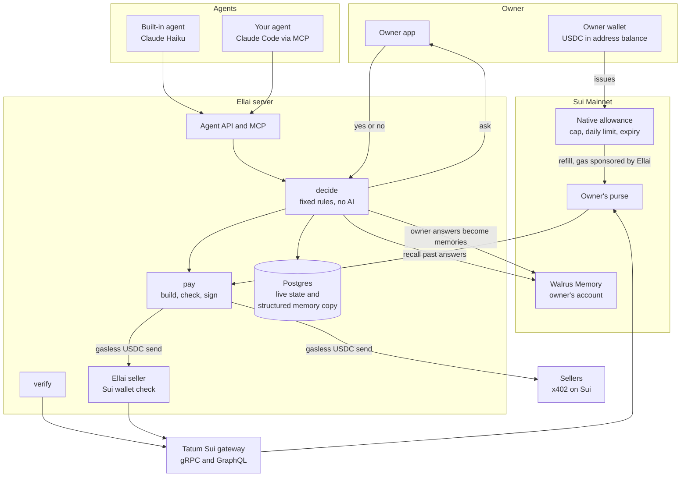
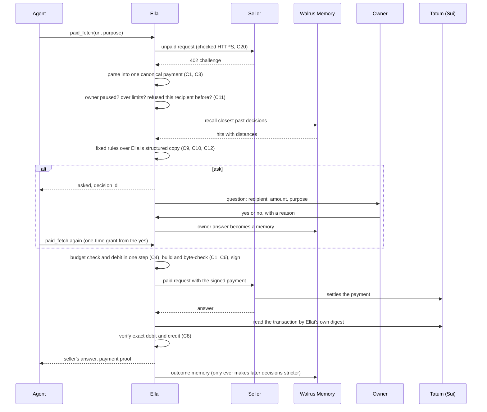
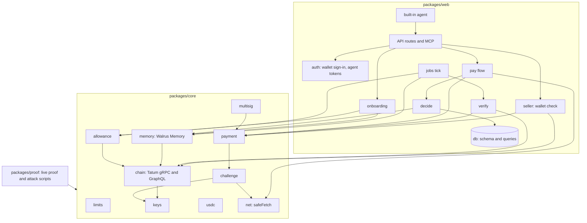

## The pieces



Your agent calls Ellai. Ellai's decision step applies fixed rules and recalls your past answers from your Walrus Memory account. If it needs you, the question goes to the owner app and your yes or no comes back. If it pays, the money moves from your allowance to your purse and from the purse to the seller. Ellai reads and sends on Sui through Tatum. The one exception sits inside the Walrus Memory library: when it sets up encryption for a write or a search, it reads Sui once from the endpoint the Walrus Memory service names.

Ellai keeps two stores. Walrus Memory holds your decisions as plain sentences that you own and can read. A Postgres database holds what has to be current: sessions, agent keys (stored as hashes), decisions, answers, payments, the daily budget ledger, and a structured copy of every memory Ellai wrote. The rules read that structured copy, never the sentence text.

## One paid call, end to end

1. The agent calls `paid_fetch` with a URL and a plain purpose.
2. Ellai makes the first request to the seller itself, over checked HTTPS. The price it decides on is the one the seller really sent, not a price the agent reports.
3. The seller answers 402 with a price. Ellai turns the answer into one fixed description of the payment: recipient address, amount in whole units, coin, network and expiry. Every later step reads that one description and nothing else.
4. Ellai checks the hard limits and looks up whether you ever refused this recipient.
5. Ellai asks Walrus Memory for the closest past decisions. Each comes back with a distance.
6. Fixed rules read Ellai's own structured copy of those memories and decide: pay, refuse, or ask.
7. If the answer is ask, the agent gets "asked" and a decision id. The question appears in the app with the recipient, the amount and the purpose. You answer yes or no, with an optional reason. Your answer becomes a memory. A yes also becomes a one-time grant, and the agent calls again.
8. Before signing, Ellai checks the daily budget and records the debit in one step. It builds the payment, decodes it and checks it field by field against that one description, then signs it.
9. Ellai sends the signed payment to the seller. The seller settles it on Sui and answers.
10. Ellai reads the transaction through Tatum by the digest it computed itself, and checks one debit and one credit of the agreed amount.
11. The agent gets the seller's answer and a payment proof. If the seller took the money and returned nothing, Ellai writes an outcome memory.



The labels like C1 and C11 point to numbered rules in the [threat model](https://github.com/ramakrishnanhulk20/ellai/blob/main/docs/security/threat-model.md). The [Security](/docs/security) page explains the ones that matter most.

## The decision rules, in order

Every rule is fixed code. The first rule that matches decides.

1. Hard limits. If automatic payments are paused, or the payment is above your per-payment maximum, or it would take the last 24 hours past your daily budget, Ellai refuses.
2. A refusal always wins. Ellai looks up the recipient address in its own records. If you ever refused this address, it refuses and cites that memory. This is an exact lookup, so no purpose text, search distance or result limit can hide it.
3. Bad outcomes make Ellai stricter. If this recipient took a payment and delivered nothing, or has not yet been seen to deliver, or the payment did not match what was agreed, Ellai asks and says why. Only your yes to a question asked after that payment lifts it. A yes you gave before the seller failed does not.
4. A one-time grant. When you answer yes to a question, that yes allows exactly one payment: the same agent, the same recipient, at most the same amount, the same seller URL, method and body, within 10 minutes. Then it is used up.
5. Learned approval. Ellai recalls up to 20 of the closest past decisions from your Walrus Memory, waiting at most 15 seconds. It approves only if at least the number of approvals you set (default 2) are your own approvals for the same recipient address, at or above this amount, and closer than your distance cutoff (default 0.5). Trust follows the money: approvals for one address never count for another, whatever the website name says.
6. Otherwise ask.

Recall failures ask. If the search errors, times out, comes back empty, returns a hit with no numeric distance, or returns a full 20 hits with the farthest still inside your cutoff and too few approvals among them, Ellai asks instead of paying. A full result can only hide more approvals, never a refusal or a bad outcome, because rules 2 and 3 do not use the search.

An agent can hold at most 5 unanswered questions. Past that, a new ask becomes a refusal with the rule name `too_many_pending`. An unanswered question is closed after 24 hours.

### What "distance" means

Walrus Memory compares meaning. Each past answer comes back with a distance from 0 to 2. Smaller is closer, and 0 is the same meaning. Your cutoff says how close counts. In the live learning test every cited distance fell between 0.0893 and 0.2655.

### The numbers you control

| Setting | Range | Default |
|---|---|---|
| Per-payment maximum | 0.01 to 1.00 USDC | 0.05 USDC |
| Daily budget | up to 5.00 USDC, never below the per-payment maximum | 0.50 USDC |
| Approvals needed before Ellai pays on its own | 1 to 10 | 2 |
| Distance cutoff (how alike a past yes must be) | above 0, up to 1 (the app slider runs 0.05 to 1) | 0.5 |

### Two things the rules never do

No AI model decides about money. The built-in agent runs on Claude Haiku and chooses what to buy from a fixed catalog. Your own agent chooses what to ask for. In both cases the same rules above decide whether Ellai pays.

Only your own answers count as approval. A memory counts only when Ellai's records show that Ellai wrote it for you, from an answer you gave. Outcome memories, payments approved by the rules, and anything another tool writes into the same Walrus Memory account carry no weight. The system cannot teach itself, and an agent cannot write its own approvals.

## The money flow

1. You issue an allowance. In one transaction you let your Ellai purse draw USDC from your own address balance: a total cap, a daily limit and an end date. Your USDC does not move yet.
2. The purse is refilled in small steps. A background job runs every 10 minutes. When the purse holds less than 0.05 USDC, and fewer than 3 refills happened in the last 24 hours, Ellai pulls exactly 0.10 USDC through your allowance. The purse never holds more than 0.20 USDC right after a refill. Ellai first rehearses the refill with a dry run and sends it only if it moves exactly that amount. Ellai's own gas wallet pays the network fee, at most 0.02 SUI per refill.
3. A payment is a plain gasless USDC send from the purse to the seller. The purse needs no SUI. The smallest payment is 0.01 USDC. Before signing, Ellai decodes the transaction and checks that it is that plain send and nothing more: no extra commands, no other recipient, no other coin.
4. Tatum reads it back. Ellai computes the transaction digest from the bytes it signed, then reads that digest through Tatum. The payment is "verified" only when the effects show success, a debit of the agreed amount from your purse, and a credit of the agreed amount to the agreed recipient in USDC. If the numbers do not match, or Ellai cannot confirm in time, automatic payments pause for you until you review.

Each owner has their own purse. Ellai derives its key per owner from one master secret, so no two owners share a purse.

The daily budget counts every payment Ellai has signed in any 24 hours, whether or not it has landed yet. The check and the debit happen in one step at the moment of signing, so two requests at once cannot both pass.

A payment record shows one of four settlement states: pending (not yet seen on chain), verified, mismatch, or not landed. Only verified means Ellai saw the money arrive.

## What becomes a memory, and when

Two kinds of memory exist.

1. Your answers. The moment you answer a question, Ellai records it. A refusal binds at once, even before the memory reaches Walrus. A background job then writes the sentence to your Walrus Memory account. That job runs every 10 minutes. After Walrus Memory confirms the write and the search index has caught up, the answer can count toward learned approval. Later the job finds the memory's blob on chain, and only then can it appear on the public proof page, if you turned that on.
2. Outcomes, only when something goes wrong. If a payment is verified on chain but the seller returned nothing, Ellai writes an outcome memory. A normal delivered payment writes no memory, since it is already on chain and in Ellai's records. This keeps outcomes from crowding your own answers out of the search.

A memory sentence has this shape. The quoted purpose and reason are cleaned of quote marks and control characters, and the purpose is cut to 200 characters.

```text
On YYYY-MM-DD the owner approved paying 0.010000 USDC to RECIPIENT_ADDRESS at SELLER_HOST for "PURPOSE". Reason: "REASON".
```

A refusal reads "refused" in place of "approved". An outcome reads "On YYYY-MM-DD Ellai finished paying ... and the seller returned nothing." Each sentence is at most 1,000 characters. A write that keeps failing ends in a visible "failed" state, which you can see in the Memories screen. The limits are 5 refused attempts, or a write job still unfinished after 6 hours. The reason you type is stored in Walrus Memory, so keep private details out of it.

## What Ellai can pay today

Ellai pays USDC on Sui Mainnet to sellers that use x402 version 1, in the form t2000 sellers send it. A price request must offer exactly one payable option, and every copy of a value in it must agree. Ellai refuses anything ambiguous.

Not yet: x402 version 2 is read but not paid, and MPP payment requests are not supported. A seller using them gets a refusal with a plain reason. Ellai also sends only GET and POST requests, over HTTPS on port 443.

## How the code is split

The packages are small and each has one job. `core` holds every limit, the Sui calls, the payment parser and the allowance and memory code. `web` holds the database, sign-in, the rules, the pay flow, the routes and the background jobs. `proof` holds the live proof scripts.


